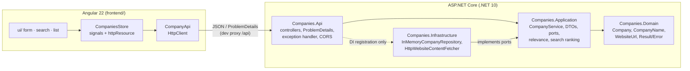
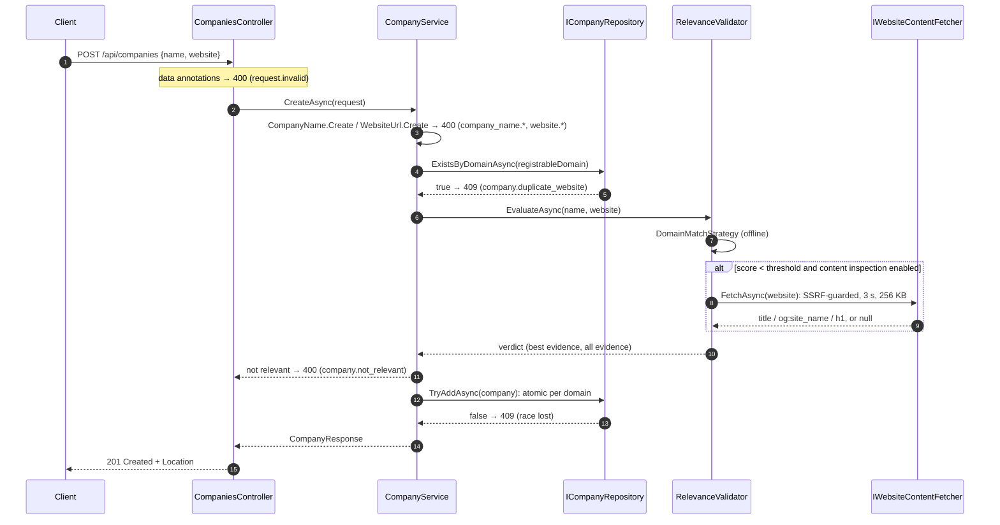

# Architecture

## Layers

**Dependency rule:** Api → Application ← Infrastructure, and Application → Domain. Project references enforce it, and [`LayerDependencyTests`](../backend/tests/Companies.UnitTests/Architecture/LayerDependencyTests.cs) checks it:
- Domain references no other project.
- Application references only Domain.
- Infrastructure never references Api, and its only public type is `DependencyInjection`.

| Layer | Responsibility | Key types |
|---|---|---|
| Domain | Invariants that hold everywhere. An invalid company can't be constructed. | `Company` (Guid v7 id, `Create` / `Restore`), `CompanyName`, `WebsiteUrl` (canonical URL, registrable domain, label), `DomainNameParser` + `PublicSuffixList` (embedded Public Suffix List snapshot), `Result<T>`, `Error` |
| Application | Use cases and policy: uniqueness, relevance, search, paging. Defines the ports it needs. | `ICompanyService` / `CompanyService`, `CompanyQueryParser`, `IRelevanceValidator` + `IRelevanceStrategy` (`DomainMatchStrategy`, `ContentInspectionStrategy`), `CompanySearchRanker`, `ICompanyRepository`, `IWebsiteContentFetcher`, contracts (`CreateCompanyRequest`, `CompanyResponse`, `CompanyQuery`, `PagedResponse<T>`) |
| Infrastructure | Port implementations: storage, outbound HTTP. | `InMemoryCompanyRepository` + `internal CompanyRecord`, `HttpWebsiteContentFetcher`, `GuardedHttpHandler`, `IpAddressGuard`, `HtmlMetadataParser` |
| Api | HTTP only: binding, status codes, error format, pipeline. | `CompaniesController`, `CompanyListParameters`, `ErrorResults`, `InvalidRequestResponseFactory`, `GlobalExceptionHandler` |

## Creating a company

Validation happens in layers, and each layer has its own job:
1. **Data annotations** on `CreateCompanyRequest` give fast field-level feedback and document the contract in OpenAPI.
2. **Value objects** are the source of truth for format. They normalize the input first (trimming, canonical URL, Unicode host).
3. **Uniqueness** is checked before relevance, so a known duplicate never triggers a home-page fetch, and again atomically on insert.
4. **Relevance** is policy and lives in the Application layer, as a pluggable list of strategies.

## Listing and searching

`GET /api/companies?name=&domain=&q=&sort=&page=&pageSize=`:
1. `CompanyQueryParser` validates the query and returns 400 (`query.*`) for bad paging, an unknown sort, `relevance` without `q`, or filters over 200 chars.
2. The filter (name substring, exact registrable domain or host fragment) goes to `ICompanyRepository.ListAsync`. These are the criteria a database would apply in a `WHERE` clause.
3. When `q` is set, `CompanySearchRanker` scores each candidate with explainable rules (exact 1.0 › prefix 0.8 › word prefix 0.7 › all words 0.6 › contains 0.5 › domain 0.4 › fuzzy 0.3), drops non-matches and orders them best first.
4. The results are sorted and paged, and returned as `PagedResponse<CompanyResponse>`. An empty page is a normal 200.

## Cross-cutting concerns

- **Errors.** Expected failures are `Result<T>`/`Error` values, never exceptions. `ErrorResults.ToProblem` is the one place where an `ErrorType` becomes a status code (Validation 400, NotFound 404, Conflict 409). Every problem response carries `code`, `detail` and `traceId`, and field errors are keyed by JSON name. Unhandled exceptions become a generic 500 that leaks nothing. A request the client aborted gets 499.
- **Logging.** Source-generated `[LoggerMessage]` methods:
  - Information: company created, not found, relevance decision with strategy and score.
  - Warning: rejected requests (type, code, message) and home-page fetch failures.
  - Error: unhandled exceptions.
  - Debug: searches.
- **Configuration.** Options classes validated at startup: `Relevance` (threshold, content inspection on/off), `WebsiteFetcher` (timeout, size, redirects, user agent), `Cors`.
- **Security.**
  - The home-page fetch can only reach public IP addresses. This is enforced in `ConnectCallback`, so it applies to every connection, including after DNS rebinding.
  - Redirects are followed manually and re-validated.
  - Proxy and cookies are off.
  - URLs containing credentials are rejected.
  - CORS allows only the configured origins.

## Extensibility

| Change | Where |
|---|---|
| Real database | A new `ICompanyRepository` (e.g. EF Core) plus one registration line in `AddInfrastructure` ([ADR 003](decisions/003-persistence.md)) |
| Update / delete | `PUT`/`PATCH`/`DELETE /api/companies/{id}` in the same controller → new `ICompanyService` methods → repository methods. `Company.Restore` and the value objects already validate updates. |
| Another relevance signal | Implement `IRelevanceStrategy` and register it. Registration order is evaluation order, and evaluation stops at the first passing strategy. |
| Different search ranking or full-text search | Replace `ICompanySearchRanker`, or push `q` into the repository for a database full-text index |
| More filters or sort keys | `CompanyQuery` + `CompanyQueryParser` + `CompanyFilter` |

## Testing strategy

| Suite | Scope | Count |
|---|---|---|
| `Companies.UnitTests` (NUnit, Shouldly, NSubstitute) | Value objects, domain parser, normalizer, Jaro-Winkler, each relevance strategy, validator ordering, ranker, service paths (with `FakeTimeProvider` / `FakeLogger`), repository incl. concurrency, IP guard, real guarded handler against loopback, HTML parser, fetcher (redirects, limits, timeout, cancellation), architecture rules | 265 |
| `Companies.Api.IntegrationTests` (`WebApplicationFactory`) | Every endpoint and status code over HTTP, ProblemDetails shape, CORS, 500 without leaks, DI validation | 48 |
| Frontend (Vitest, `HttpTestingController`) | Problem parsing, API client, store, form (client and server errors), search, list, page | 33 |

Assertions use Shouldly only; NUnit's `Assert` is banned by an analyzer. Key tests were checked by mutation: deliberately breaking the guarded code (a ranker weight, the duplicate check, the IP check, redirect validation, the output-name bug) made them fail.

## Spec coverage

| Spec section | Requirement | Where |
|---|---|---|
| 1 Submission | Accept a JSON company; validate; persist in memory; 201/200; 400 with a concise message | `POST /api/companies` → `CompanyService.CreateAsync`; `CreatedAtAction` → 201 + Location; `ValidationProblemDetails` with a one-line `detail` |
| 2 Validation | Name not empty, at least a few characters | `[Required]`, `[StringLength(200, MinimumLength = 3)]`, `CompanyName.Create` (also requires a letter or digit) |
| | Valid, well-formed URL | `[Url]`, `WebsiteUrl.Create` (absolute http/https, public DNS host, no credentials, ≤ 2048 chars) |
| | Name relevant to URL, explainable strategy | `RelevanceValidator`: domain match, then home-page inspection ([ADR 002](decisions/002-relevance-strategy.md)) |
| | 400 with a concise message on any failure | `ErrorResults`, `InvalidRequestResponseFactory` |
| 3 Persistence | In memory only, no database | `InMemoryCompanyRepository` (`ConcurrentDictionary`) |
| | A database can be added with minimal change | Async `ICompanyRepository` port; swap one DI line ([ADR 003](decisions/003-persistence.md)) |
| | Storage not exposed outside the layer | `internal CompanyRecord`; only DTOs cross the API; checked by an architecture test |
| 4 Access | Create, get all, get by id | `POST`, `GET`, `GET /{id:guid}` |
| | Filter by partial/full name and website domain | `?name=`, `?domain=` |
| | Relevance search ordered by relevance | `?q=` → `CompanySearchRanker`, `relevanceScore` |
| | Empty results handled gracefully | 200 with `items: []`; two empty states in the UI |
| | Correct methods and codes (200/201/400/404) | Integration tests assert each one; 409/415/500 where they apply |
| | DTOs, no internal models exposed | `CompanyResponse`, `PagedResponse<T>`, `CreateCompanyRequest` |
| | RESTful routes and query design | [ADR 001](decisions/001-api-design.md) |
| | No business logic in controllers | Each action is one service call plus `Result.Match` |
| | Extensible (update, delete, paging, sorting) | Paging and sorting implemented; see Extensibility above |
| 5 Structure | Separation of concerns, abstractions, low coupling, clean code | 4 projects, ports and adapters, [CONVENTIONS.md](../CONVENTIONS.md), warnings as errors |
| 6 Angular | Form for name and URL; success and error messages; list stored companies | `company-form` (Signal Forms, field and form-level errors), `company-list`, `company-search` |
| 7 Practices | HTTP codes; clear validation and friendly messages | Mapping in one place; human-readable `detail` everywhere |
| | Modern C# (async/await, records, data annotations) | Records, primary constructors, collection expressions, `[GeneratedRegex]`, `FrozenSet`, `TimeProvider`, Guid v7, nullable + analyzers |
| | Logging for key operations and errors | `[LoggerMessage]` in service, validator, fetcher, exception handler |
| | Unit tests for business logic and API behaviour | 313 backend + 33 frontend tests |
| Running | `dotnet run` on 5000/7000; Angular dev server | `launchSettings.json` (https profile default); `npm start` with proxy |
| Submission | Source and README with setup | This repository; [README](../README.md) |
